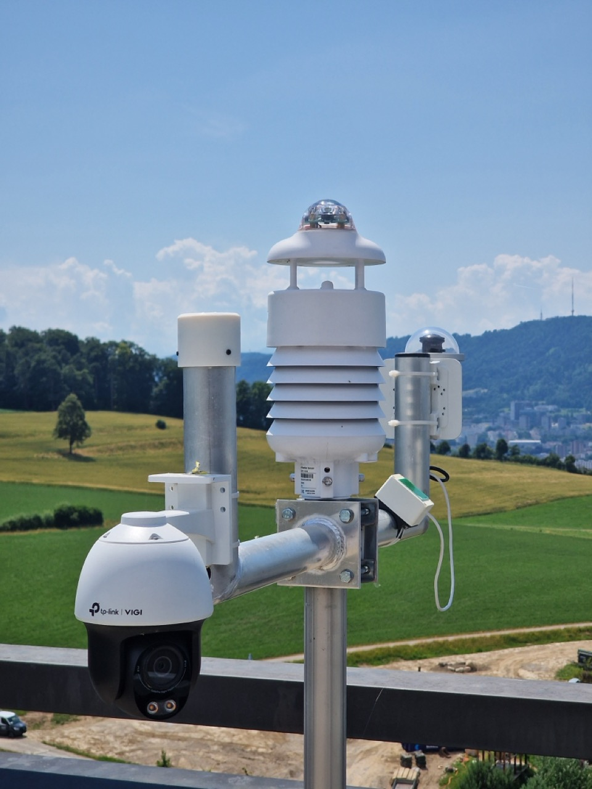

# Alpaca Weather Station

Custom Arduino Opta PLC weather station and safety controller for observatory automation that monitors environmental conditions and provides real-time weather data to prevent telescope damage.



## Purpose

This PLC acts as a comprehensive weather monitoring system that:
- Reads weather data from a SenseCAP S700 weather station via RS485
- Monitors sky temperature using infrared sensors
- Detects rain using a dedicated rain sensor
- Checks all conditions against configurable safety limits
- Controls a safety relay to cut power when conditions become unsafe
- Exposes ASCOM Alpaca ObservingConditions and SafetyMonitor APIs
- Provides a web interface for configuring safety limits

## How It Works

### Main Components

The system continuously monitors weather conditions using three hardware interfaces:

1. **S700 Weather Station** (RS485): Provides 16 weather parameters including:
   - Air temperature and humidity
   - Barometric pressure
   - Light intensity
   - Wind speed, gust speed, and direction
   - Rainfall data

2. **MLX90614 IR Sensors** (I2C): Two sensors measure sky temperature
   - Detects cloud cover (clouds are warmer than clear sky)
   - Calculates relative sky temperature vs. ambient

3. **Rain Sensor** (Analog pin A7): Kemo M152K sensor for direct rain detection
   - Provides backup to weather station rain detection
   - More sensitive for immediate response

### Logic Flow

```
┌─────────────────────────────────────────────────────────┐
│                    MAIN LOOP (loop)                     │
│  - Listens for HTTP requests                            │
│  - Serves web interface and API                         │
│  - Kicks watchdog while sensor thread is alive          │
└─────────────────────────────────────────────────────────┘
                              ↓
┌─────────────────────────────────────────────────────────┐
│            SENSOR THREAD (readSensors)                  │
│  Runs continuously in background every ~1 second        │
└─────────────────────────────────────────────────────────┘
                              ↓
        ┌─────────────────────┴─────────────────────┐
        ↓                                           ↓
┌──────────────────┐                    ┌──────────────────────┐
│ Read Weather     │                    │ Read Sky Temp        │
│ Station (RS485)  │                    │ Sensors (I2C)        │
│ - Send "0XA;G0?" │                    │ - MLX1 (0x5A)        │
│ - Parse response │                    │ - MLX2 (0x5B)        │
│ - Store 16 values│                    │ - Calculate relative │
└──────────────────┘                    └──────────────────────┘
        ↓                                           ↓
        └─────────────────────┬─────────────────────┘
                              ↓
                 ┌────────────────────────┐
                 │   SAFETY CHECK         │
                 │  (safetyCheck)         │
                 └────────────────────────┘
                              ↓
        ┌─────────────────────┴─────────────────────┐
        ↓                                           ↓
┌──────────────────┐                    ┌──────────────────────┐
│ Check Limits     │                    │ Check Rain Sensor    │
│ - Temperature    │                    │ - Analog pin > 10    │
│ - Humidity       │                    │ - Sets rainSensorSafe│
│ - Wind speeds    │                    └──────────────────────┘
│ - Light          │                               ↓
│ - Sky temp       │                    ┌──────────────────────┐
│ - Rainfall       │                    │   SET SAFETY FLAG    │
└──────────────────┘                    │  (isSafe = true/false)│
        ↓                                └──────────────────────┘
        └─────────────────────┬─────────────────────┘
                              ↓
                 ┌────────────────────────┐
                 │   CONTROL RELAY        │
                 │  - D0 relay            │
                 │  - LED_D0 indicator    │
                 │  - 10s delay on unsafe │
                 └────────────────────────┘
```

### Safety Logic

The system evaluates safety by checking:

| Parameter | Safe Condition | Default Limits |
|-----------|---------------|----------------|
| Air Temperature | AT_min ≤ temp ≤ AT_max | 0°C to 50°C |
| Humidity | AH_min ≤ RH ≤ AH_max | 0% to 80% |
| Light Intensity | lux ≤ LX_max | ≤ 10,000 lux |
| Wind Speed (avg) | speed ≤ SA_max | ≤ 15 m/s |
| Wind Gust | gust ≤ SM_max | ≤ 20 m/s |
| Sky Temperature | ST_min ≤ temp ≤ ST_max | -80°C to -30°C |
| Relative Sky Temp | temp ≤ RST_max | ≤ -20°C |
| Rain Detection | No active rain sensor | Digital/Analog |
| Rainfall Rate | RI = 0 and Rp = 0 | 0 mm/h |
| Station Tilt | TILT = 0 | Station upright |
| Sensor Data | Valid S700 and MLX readings this cycle | - |

**When ANY condition fails:**
1. `isSafe` flag is set to `false`
2. Safety relay (D0) switches to LOW (power cut)
3. LED indicator (LED_D0) turns off
4. System maintains unsafe state for configurable duration (default 10s)
5. Even if conditions improve, relay stays off for the full duration

**When ALL conditions pass:**
1. After the safety duration expires, `isSafe` becomes `true`
2. Safety relay switches to HIGH (power restored)
3. LED indicator turns on

### Multi-Threading Architecture

The code uses **RTOS threads** to handle concurrent operations:

- **Main Thread** (`loop`): Handles HTTP requests, web interface, API calls
- **Sensor Thread** (`readSensors`): Continuously reads sensors and evaluates safety
- **Watchdog Timer**: Resets the system if either thread stops (20-second timeout). `loop()` kicks the watchdog only while the sensor thread finishes a cycle at least every 15 seconds.

This ensures the web interface stays responsive even while sensors are being polled.

## Hardware Setup

**Arduino Opta PLC** with:
- **Ethernet connection** (required for network APIs)
- **RS485 interface** for S700 weather station (9600 baud)
- **I2C bus** (pins 11, 12) for two MLX90614 sensors at addresses 0x5A and 0x5B
- **Analog input A7** for Kemo M152K rain sensor
- **Analog output A6** provides HIGH signal to rain sensor
- **Digital output D0** controls safety relay
- **LED D0** indicates safety status
- **Built-in LED** flashes during normal operation

**Sensor Wiring:**
- S700 Weather Station: Connect to RS485 A/B terminals
- MLX90614 sensors: Connect to I2C SDA/SCL (pins 11, 12)
- Rain sensor: Signal to A7, power HIGH on A6

## Web Interface

Access the configuration UI at `http://192.168.1.12/`

The interface provides a dark-themed form to configure all safety limits:
- Temperature range (min/max in °C)
- Humidity range (min/max in %)
- Wind speed maximum (m/s)
- Gust wind maximum (m/s)
- Light intensity maximum (lux)
- Sky temperature range (min/max in °C)
- Relative sky temperature maximum (°C)
- Safety false duration (seconds to maintain unsafe state)

All settings are **persisted to flash memory** and survive power cycles.

The top of the page shows the current safety state, the last sensor error, the uptime, the cause of the last reset (power on, watchdog, brown-out and so on) and the heap in use. Use it to find out why the board restarted.

Alpaca clients find the same page at `/setup`, `/setup/v1/safetymonitor/0/setup` and `/setup/v1/observingconditions/0/setup`.

## ASCOM Alpaca APIs

The device follows the [Alpaca Device API](https://ascom-standards.org/api/) and serves two devices: SafetyMonitor 0 (`ISafetyMonitorV3`) and ObservingConditions 0 (`IObservingConditionsV2`).

- **Discovery**: answers `alpacadiscovery1` broadcasts on UDP port 32227.
- **Management API**: `/management/apiversions`, `/management/v1/description`, `/management/v1/configureddevices`.
- **Common members** for both devices: `connected` (GET/PUT), `connect`, `disconnect`, `connecting`, `name`, `description`, `driverinfo`, `driverversion`, `interfaceversion`, `supportedactions`, `devicestate`. `action` and `command*` return "not implemented".

### Safety Monitor API
Base URL: `http://192.168.1.12/api/v1/safetymonitor/0/`

| Endpoint | Method | Description | Returns |
|----------|--------|-------------|---------|
| `/issafe` | GET | Overall safety status | `true`/`false` |
| `/devicestate` | GET | Operational state | `[{"Name":"IsSafe","Value":true}]` |

`IsSafe` does not depend on the connected state. All clients share one connected state, so one client that disconnects must not make the state unsafe for the others. The ASCOM interface says `IsSafe` should be `false` while disconnected; this device does not do that on purpose. The hard-wired safety relay also does not depend on the connected state.

### Observing Conditions API
Base URL: `http://192.168.1.12/api/v1/observingconditions/0/`

| Endpoint | Description | Units | Value Source |
|----------|-------------|-------|--------------|
| `/temperature` | Ambient air temperature | °C | S700 AT |
| `/humidity` | Relative humidity | % | S700 AH |
| `/dewpoint` | Calculated dew point | °C | Formula* |
| `/pressure` | Barometric pressure at the station | hPa | S700 AP |
| `/skybrightness` | Light intensity | lux | S700 LX |
| `/windspeed` | Average wind speed | m/s | S700 SA |
| `/windgust` | Peak wind gust | m/s | S700 SM |
| `/winddirection` | Average wind direction, 0 when there is no wind | degrees | S700 DA |
| `/rainrate` | Rainfall intensity | mm/h | S700 RI + sensor |
| `/skytemperature` | IR sky temperature | °C | Max(MLX1, MLX2) |
| `/averageperiod` | Always 0 (median filtered, not time averaged). PUT accepts only 0. | hours | - |
| `/sensordescription?SensorName=` | Description of one sensor | - | - |
| `/timesincelastupdate?SensorName=` | Seconds since the last valid reading, -1 if none yet. An empty name gives the newest of all sensors. | s | - |

`cloudcover`, `skyquality`, `starfwhm` and `refresh` return NotImplemented (0x400).

If a sensor has no valid reading for 60 seconds, its value returns a driver error (0x500) instead of an old value. While the device is disconnected, sensor values return NotConnected (0x407).

Two extra members are kept for existing scripts. They are not part of the ASCOM interface:

| Endpoint | Description | Units |
|----------|-------------|-------|
| `/relativeskytemperature` | Sky temp - air temp | °C |
| `/rawmlx` | Raw MLX sensor data | JSON object |

*Dew point uses formula from Górnicki et al., 2017 (M1 model)

Every reply has `ClientTransactionID`, `ServerTransactionID`, `ErrorNumber` and `ErrorMessage`, and `Value` when there is no error. Parameter names are not case sensitive. An unknown endpoint or a missing or invalid parameter returns HTTP 400.

## Compilation & Upload

Requires [arduino-cli](https://arduino.github.io/arduino-cli/) installed with the Arduino Mbed Opta core (custom core: https://github.com/ppp-one/ArduinoCore-mbed, or use the default Arduino Mbed core, however HTTP queries will be slower with the default core).

```bash
# Compile (adjust FQBN to your installed core)
arduino-cli compile --fqbn arduino-git:mbed:opta ./

# Upload to Opta PLC (replace port as needed)
arduino-cli upload -p /dev/cu.usbmodem1301 --fqbn arduino-git:mbed:opta ./
```

## Configuration

Edit the IP address in `alpaca-weather-station.ino`:
```cpp
byte ip[] = {192, 168, 1, 12};  // Change to match your network
```

Default safety limits can be modified in the `WeatherLimits` struct at the top of the file.

## Maintenance & Troubleshooting

### LED Status Indicators
- **Built-in LED**: Flashes every ~1 second when operating normally
- **LED_D0**: ON when safe, OFF when unsafe

### Common Issues

**No data from weather station:**
- Check RS485 wiring (A/B terminals)
- Verify weather station address is `0XA` (check with manual commands)
- Ensure baud rate is 9600
- The web page shows "No data received from weather station"

**MLX sensors not detected:**
- Verify I2C addresses (0x5A and 0x5B)
- Check SDA/SCL wiring to pins 11, 12
- At startup the system tries each sensor 3 times, then continues. The relay stays unsafe and the web page shows the sensor error.

**Safety relay not triggering:**
- Check if limits are properly configured via web interface
- Verify rain sensor connection to A7
- Set `DEBUG = true` and use the Serial monitor to see which limit is being violated
- Check `safety_false_duration` setting

**Settings not persisting:**
- Flash memory initialization error - check Serial output
- Ensure Flash IAP block device initialized successfully
- Try resetting to defaults and reconfiguring

### Serial Debugging

Connect to Serial port at 9600 baud. Startup messages are always printed. Set `DEBUG = true` in the sketch to also see the sensor thread messages. Keep `DEBUG` off in normal use: a Serial write blocks while a host has the USB port open but does not read it, and the watchdog then resets the board.

You can then see:
- Weather station communication
- Safety check failures (which limit was violated)
- Sensor initialization status
- Flash memory operations
- Network configuration

### Watchdog Timer

The system includes a 20-second watchdog that will reset the PLC if:
- The sensor thread does not finish a cycle in 15 seconds
- The main loop stops responding
- The firmware crashes (a crash halts the board, and the watchdog then resets it)

The safety relay is off (unsafe) during the restart. The web page shows the cause of the last reset.

## Code Structure

### Key Functions

| Function | Purpose | Thread |
|----------|---------|--------|
| `setup()` | Initialize hardware, network, sensors, flash storage | Main |
| `loop()` | Handle HTTP requests and discovery, kick watchdog while the sensor thread is alive | Main |
| `readSensors()` | Read all sensors every ~1s, evaluate safety | Sensor |
| `readWeatherStation()` | Query S700 via RS485 | Sensor |
| `parseWeatherStation()` | Check and parse the S700 reply by key | Sensor |
| `safetyCheck()` | Compare all readings against limits | Sensor |
| `setupPage()` | Serve status and HTML form for safety limits | Main |
| `submit()` | Process form submission, save to flash | Main |
| `safetyMonitorEndPoint()` | Handle SafetyMonitor API requests | Main |
| `conditionsEndPoint()` | Handle ObservingConditions API requests | Main |
| `getLimits()` | Read safety limits from flash | Main |
| `setLimits()` | Write safety limits to flash | Main |

### Data Flow

1. **Sensor Thread** reads hardware → stores in global variables
2. **Main Thread** reads global variables → sends via HTTP
3. **Flash Storage** persists `currentLimits` struct across reboots
4. **Safety Relay** directly controlled by sensor thread

### Global Variables (Shared Between Threads)

- `isSafe`: Current safety status (read by API, written by sensor thread)
- `WSValues[16]`: Weather station readings array
- `skyTemperature`, `relativeSkyTemperature`: IR sensor values
- `currentLimits`: Active safety thresholds
- `sensorError`: Why the last sensor cycle failed (points to a fixed text)
- `sensorHeartbeat`, `lastWeatherUpdate`, `lastSkyUpdate`: Times used by the watchdog and for stale data

Each shared value is written in one 32-bit step, so the web server never reads half a value. ASCOM errors are kept per request.

## References

- [ASCOM Alpaca API Specification](https://ascom-standards.org/api/)
- [SenseCAP S700 User Guide](https://files.seeedstudio.com/products/SenseCAP/SenseCAP_ONE/SenseCAP_ONE_V2_Compact_Weather_Station_User_Guide.pdf)
- [Arduino Opta Manual](https://docs.arduino.cc/tutorials/opta/user-manual/)
- [MLX90614 IR Sensor Datasheet](https://www.melexis.com/en/product/MLX90614/)
- [Multithreading on Opta](https://opta.findernet.com/en/tutorial/multithreading-opta-and-serie-7m)

## License

MIT License - see [LICENSE](LICENSE)
